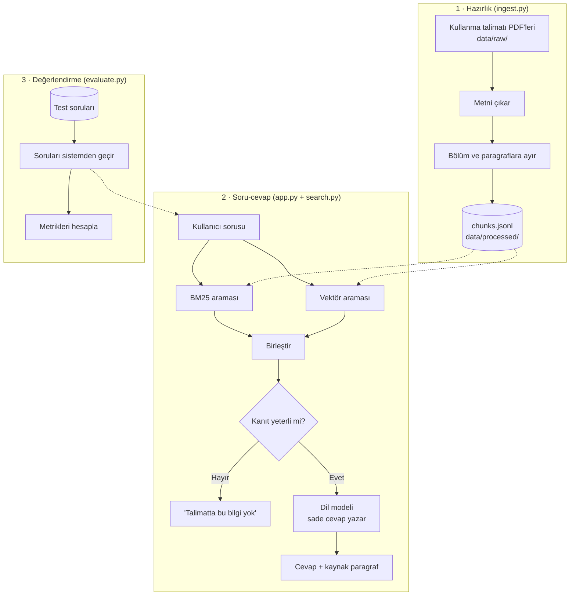
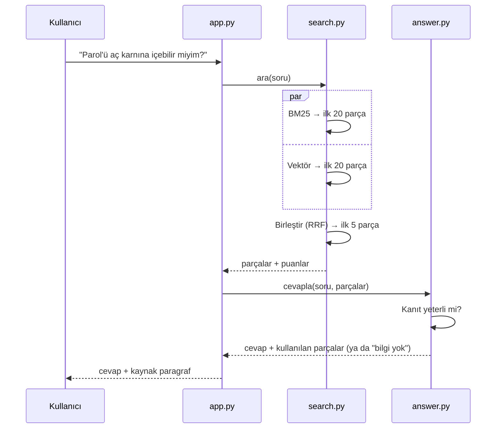

# 3. Mimari

Bu doküman sistemin **hangi parçalardan oluştuğunu**, **verinin nasıl aktığını** ve **dosyaların nasıl düzenlendiğini** anlatır.

> Mimari bir defada kurulmayacak. [Yol haritasındaki](08-yol-haritasi.md) her aşama bu resme bir parça ekler. Bölüm 3.6'daki tablo hangi parçanın ne zaman geleceğini gösterir.

---

## 3.1 Kuş bakışı

Sistemin üç akışı var:

1. **Hazırlık (ingest):** Kullanma talimatlarını okur, paragraflara böler ve aramaya hazırlar. Yeni belge eklendiğinde bir kez çalışır.
2. **Soru-cevap:** Kullanıcının sorusunu alır, arar, birleştirir, kanıtı kontrol eder ve cevaplar. Her soruda çalışır.
3. **Değerlendirme:** Test setindeki soruları sistemden geçirir ve başarıyı ölçer.



## 3.2 Bileşenler

| Dosya | Görevi | Girdi → Çıktı | Aşama |
|---|---|---|---|
| `ingest.py` | PDF'ten metni çıkarır, bölüm başlıklarına ve paragraflara böler | PDF'ler → `chunks.jsonl` | 1 |
| `search.py` | BM25, vektör ve hibrit arama | Soru → sıralı paragraf listesi | 2–4 |
| `app.py` | Streamlit arayüzü: soru kutusu, sonuçlar, kaynaklar | Kullanıcı ↔ sistem | 0'dan itibaren |
| `answer.py` | Bulunan paragraflardan dil modeliyle cevap üretir, kanıt kontrolü yapar | Soru + paragraflar → cevap | 6 |
| `evaluate.py` | Test setinde arama ve cevap başarısını ölçer | Test soruları → metrik tablosu | 5, 7 |

Dosyalar büyüdükçe bir pakete (`src/ilac_asistani/`) taşınacak. İlk aşamalarda sade tutuyoruz.

## 3.3 Veri biçimi: `chunks.jsonl`

Her satır bir paragraf (parça). Kullanma talimatları aynı başlıklarla yazıldığı için her parçaya bölüm adını da ekliyoruz. Böylece arama sonucu "Parol, 2. Kullanmadan önce dikkat edilmesi gerekenler" gibi gösterilebilir.

```json
{"chunk_id": "parol-2-003", "ilac": "Parol", "bolum": "2. PAROL'ü kullanmadan önce dikkat edilmesi gerekenler", "metin": "Hamilelik döneminde ...", "kaynak": "parol.pdf", "sayfa": 2}
```

**Önemli tasarım kararı:** Her parçanın **tek ve kalıcı bir kimliği** (`chunk_id`) var. BM25 de vektör araması da aynı kimliği döndürür. Birleştirme ancak böyle mümkün olur.

## 3.4 Soru anında ne oluyor?



## 3.5 Cevap verme kuralı

Sistemin en önemli kuralı: **kanıt yoksa cevap yok.**

1. Arama sonucundaki en iyi parçanın puanı belirli bir eşiğin altındaysa sistem cevap üretmez.
2. Eşik geçilse bile dil modeline "yalnızca verilen paragraflara dayan, paragraflarda yoksa 'bilgi yok' de" talimatı verilir.
3. Her cevabın altında kullanılan paragraf ve hangi talimattan, hangi bölümden geldiği gösterilir.
4. Ekranda her zaman "tıbbi tavsiye değildir" uyarısı bulunur.

Eşiğin değeri tahminle değil, test setindeki "cevabı olmayan" sorular kullanılarak ölçümle seçilir ([Değerlendirme](07-degerlendirme.md)).

## 3.6 Klasör yapısı

```
bitirme/
├── README.md
├── CLAUDE.md               # oturumlar arası proje notları
├── pyproject.toml          # proje ve kütüphaneler (uv)
├── uv.lock                 # kütüphanelerin tam sürümleri
├── .github/                # CI, PR ve issue şablonları
├── docs/                   # bu dokümanlar
│
├── app.py                  # arayüz
├── ingest.py               # hazırlık          (Aşama 1)
├── search.py               # arama             (Aşama 2–4)
├── answer.py               # cevap üretimi     (Aşama 6)
├── evaluate.py             # ölçüm             (Aşama 5, 7)
│
└── data/
    ├── raw/                # PDF'ler, git'e girmez
    ├── processed/          # chunks.jsonl, git'e girmez
    └── testset/            # test soruları, git'e girer (Aşama 5)
```

## 3.7 Mimarinin evrimi

| Sürüm | Aşama | Ne var | Nasıl çalışır |
|---|---|---|---|
| **v0: Arama prototipi** | 0–4 | Hazırlık, BM25, vektör, hibrit arama; sonuçlar ekranda yan yana | `uv run streamlit run app.py` |
| **v1: Ölçülen sistem** | 5 | Test seti ve arama metrikleri | `uv run python evaluate.py` |
| **v2: Asistan** | 6–7 | Kaynaklı cevap, kanıt kontrolü, cevap değerlendirmesi | Aynı arayüz |
| **v3: Ürün** | 8 | Daha fazla ilaç, sade arayüz, canlı demo | İnternette bir adres |
