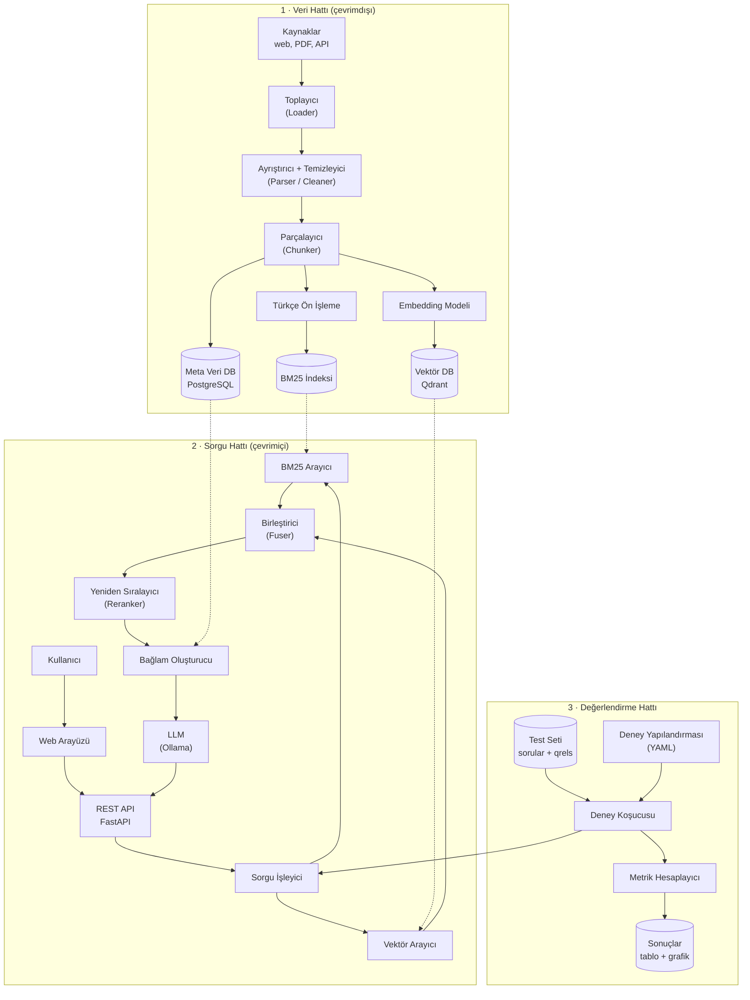
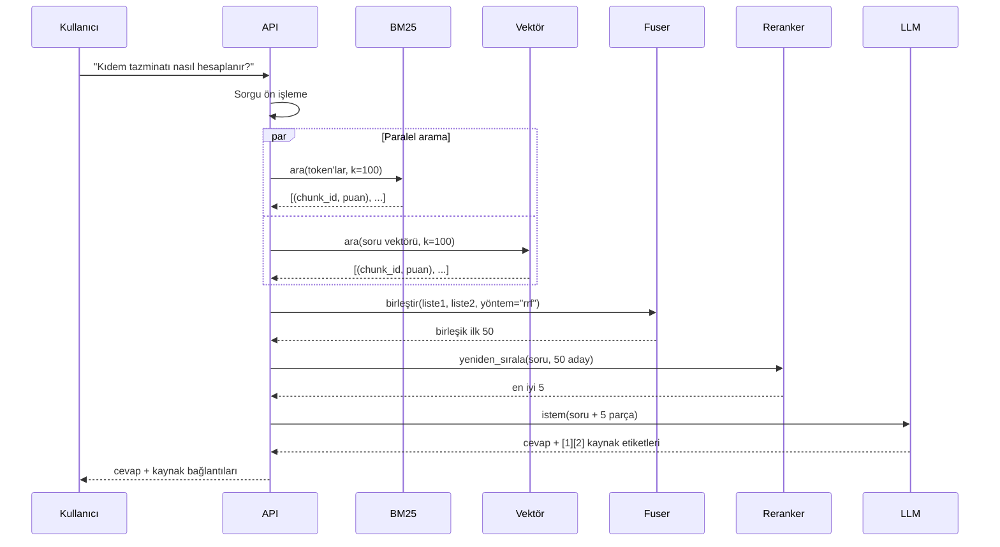
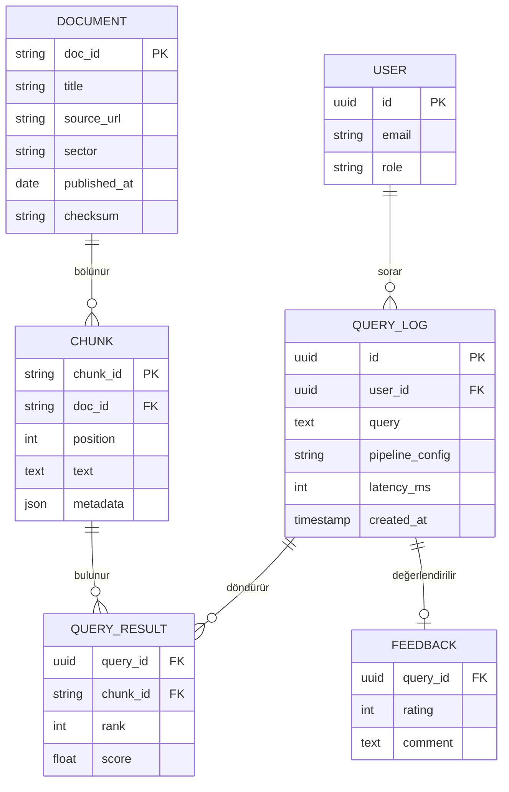

# 3. Mimari

Bu doküman sistemin **hangi parçalardan oluştuğunu**, **verinin nasıl aktığını** ve **kodun nasıl düzenleneceğini** anlatır.

> Mimari bir defada kurulmayacak. [Yol haritasındaki](08-yol-haritasi.md) her faz bu resmin bir parçasını ekleyecek. Bölüm 3.7'deki "evrim" tablosu hangi parçanın ne zaman geleceğini gösterir.

---

## 3.1 Kuş bakışı

Sistem üç ana akıştan oluşur:

1. **Veri hattı (ingestion), çevrimdışı:** Belgeleri toplar, temizler, parçalar ve indeksler. Belge eklendiğinde çalışır.
2. **Sorgu hattı (query), çevrimiçi:** Kullanıcının sorusunu alır, arar, birleştirir, sıralar ve cevaplar. Her soruda çalışır.
3. **Değerlendirme hattı (evaluation):** Test setindeki soruları sorgu hattından geçirir, metrikleri hesaplar ve deneyleri kaydeder.



## 3.2 Veri hattı ayrıntısı

| Adım | Girdi | Çıktı | Örnek araç | Dikkat edilecekler |
|---|---|---|---|---|
| **Toplama** | URL listesi, dosyalar | Ham HTML/PDF | `httpx`, `Playwright` | robots.txt, hız sınırı, lisans |
| **Ayrıştırma** | HTML/PDF | Düz metin + yapı (başlık, madde) | `trafilatura`, `PyMuPDF`, `Docling` | Tablolar, sayfa altlıkları, OCR |
| **Temizleme** | Ham metin | Temiz metin | Kendi kodumuz | Unicode normalizasyonu, tekrar eden başlıklar, boşluklar |
| **Parçalama** | Temiz metin | Parçalar (chunk) | Kendi kodumuz | Boyut, örtüşme, yapısal sınırlar |
| **Ön işleme** | Parça metni | Token listesi | Kendi kodumuz + Snowball/Zeyrek | Türkçe küçük harf, kök bulma |
| **BM25 indeksleme** | Token listeleri | Ters indeks | Önce kendi kodumuz, sonra `bm25s` | Parametreler: k1, b |
| **Embedding** | Parça metni | Vektör | `sentence-transformers` | Toplu işleme, GPU, model önekleri |
| **Kaydetme** | Vektör + meta | DB kayıtları | Qdrant, PostgreSQL | Kimlik (ID) tutarlılığı |

**Önemli tasarım kararı:** Her parçanın **tek ve kalıcı bir kimliği** (`chunk_id`) olacak. BM25 indeksi, vektör DB ve meta veri DB aynı kimliği kullanacak. Birleştirme ancak böyle mümkün olur.

## 3.3 Sorgu hattı ayrıntısı



**Gecikme bütçesi (hedef):**

| Adım | Hedef süre |
|---|---|
| BM25 + vektör (paralel) | < 100 ms |
| Birleştirme | < 5 ms |
| Reranking (50 aday) | < 500 ms (GPU'da çok daha az) |
| LLM cevabı | 2–10 sn (akış/streaming ile ilk kelime < 1 sn) |

## 3.4 Tasarım ilkeleri

1. **Her bileşen değiştirilebilir olsun.** BM25 yerine başka bir arayıcı, RRF yerine başka bir birleştirici tek satırla takılabilmeli. Bunun için **arayüz (interface)** ve **Strateji deseni (Strategy Pattern)** kullanacağız.
2. **Deneyler yapılandırmayla yönetilsin.** Kod değiştirmeden, YAML dosyasıyla "hangi model, hangi yöntem, hangi parametre" seçilebilmeli.
3. **Tekrarlanabilirlik.** Her deney sonucu; kullanılan yapılandırma, kod sürümü (git commit) ve veri sürümüyle birlikte kaydedilmeli.
4. **Önce basit, sonra hızlı.** Önce anlaşılır ve doğru kod, ölçüm yaptıktan sonra optimizasyon.
5. **Çekirdek ile kabuk ayrı.** Arama ve birleştirme mantığı (çekirdek), API ve arayüzden (kabuk) bağımsız bir Python paketi olacak. Deneyler de API de aynı çekirdeği kullanacak.

## 3.5 Çekirdek arayüzler (taslak)

Aşağıdaki kod **yön göstermek** içindir. Gerçek hâlini Faz 3–5'te birlikte yazacaksınız.

```python
from dataclasses import dataclass
from typing import Protocol


@dataclass(frozen=True)
class Chunk:
    chunk_id: str          # kalıcı kimlik, ör. "gvk-m94-p2"
    doc_id: str            # bağlı olduğu belge
    text: str
    metadata: dict         # başlık, madde no, tarih, URL ...


@dataclass(frozen=True)
class ScoredChunk:
    chunk_id: str
    score: float
    rank: int              # 1'den başlar


class Retriever(Protocol):
    """Bir soruya en ilgili k parçayı döndüren her şey."""
    name: str
    def search(self, query: str, k: int) -> list[ScoredChunk]: ...


class Fuser(Protocol):
    """Birden fazla sonuç listesini tek listede birleştiren her şey."""
    name: str
    def fuse(self, results: dict[str, list[ScoredChunk]], k: int) -> list[ScoredChunk]: ...


class Reranker(Protocol):
    name: str
    def rerank(self, query: str, candidates: list[Chunk], k: int) -> list[ScoredChunk]: ...
```

Bu sayede bir hibrit arayıcı şöyle kurulur:

```python
pipeline = HybridPipeline(
    retrievers=[BM25Retriever(...), DenseRetriever(...)],
    fuser=RRFFuser(k=60),
    reranker=CrossEncoderReranker(...),   # isteğe bağlı
)
```

`Fuser`'a yeni bir yöntem eklemek = yeni bir sınıf yazmak. Mevcut kodun hiçbir yerine dokunmak gerekmez (*Open/Closed* ilkesi).

## 3.6 Klasör yapısı (hedef)

```
bitirme/
├── README.md
├── docs/                     # bu dokümanlar + ileride rapor taslakları
├── pyproject.toml            # Python bağımlılıkları (uv)
├── docker-compose.yml        # Qdrant, PostgreSQL, API, UI, Ollama
├── .env.example              # ortam değişkeni şablonu (gizli bilgiler asla repoya girmez)
│
├── data/                     # ⚠ git'e girmez (.gitignore)
│   ├── raw/                  # indirilen ham dosyalar
│   ├── processed/            # temizlenmiş belgeler + parçalar (JSONL)
│   └── testset/              # sorular + qrels (bu git'e girer, küçüktür)
│
├── src/hybridrag/            # ÇEKİRDEK paket
│   ├── config.py             # ayarlar (pydantic-settings)
│   ├── models.py             # Chunk, ScoredChunk ...
│   ├── ingestion/
│   │   ├── loaders/          # kaynağa özel toplayıcılar
│   │   ├── parsers.py
│   │   ├── cleaning.py
│   │   └── chunking.py
│   ├── text/
│   │   └── turkish.py        # Türkçe küçük harf, kök bulma, stopword
│   ├── retrieval/
│   │   ├── base.py           # Retriever arayüzü
│   │   ├── bm25.py
│   │   └── dense.py
│   ├── fusion/
│   │   ├── base.py           # Fuser arayüzü
│   │   ├── normalization.py  # min-max, z-score ...
│   │   ├── rrf.py
│   │   ├── linear.py
│   │   └── comb.py           # CombSUM, CombMNZ, CombMAX
│   ├── rerank/
│   ├── generation/           # istem şablonları, LLM istemcisi
│   ├── pipeline.py           # HybridPipeline
│   └── evaluation/
│       ├── metrics.py
│       └── runner.py
│
├── api/                      # KABUK: FastAPI uygulaması
├── frontend/                 # KABUK: web arayüzü
├── experiments/
│   ├── configs/              # deney YAML'ları
│   └── results/              # deney çıktıları (json/csv)
├── notebooks/                # keşif ve analiz (kalıcı kod buraya değil src'ye)
├── scripts/                  # tek seferlik komutlar (indir, indeksle ...)
└── tests/                    # pytest testleri
```

## 3.7 Mimarinin evrimi

Sistem dört sürümde büyüyecek. Her sürüm **çalışır durumda** olacak.

| Sürüm | Faz | Ne var | Nasıl çalıştırılır |
|---|---|---|---|
| **v0: Keşif** | 0–2 | Notebook'lar, veri indirme betikleri, ilk test seti | Jupyter |
| **v1: Çekirdek kütüphane** | 3–6 | `hybridrag` paketi, BM25 + vektör + fusion + reranking, deney koşucusu | `python -m hybridrag.evaluation.runner experiments/configs/x.yaml` |
| **v2: Uygulama** | 7–8 | LLM cevabı, FastAPI, basit arayüz, Docker Compose | `docker compose up` |
| **v3: Ürün** | 9 | Kullanıcı girişi, belge yükleme, izleme, testler, CI/CD, canlı ortam | Sunucuda |

## 3.8 Veri modeli (PostgreSQL, v2–v3)



`QUERY_LOG` ve `FEEDBACK` tabloları ürünün **kendini geliştirmesini** sağlar. Gerçek kullanıcı soruları ve geri bildirimleri ileride test setine ve Learning-to-Rank modeline veri olur.
